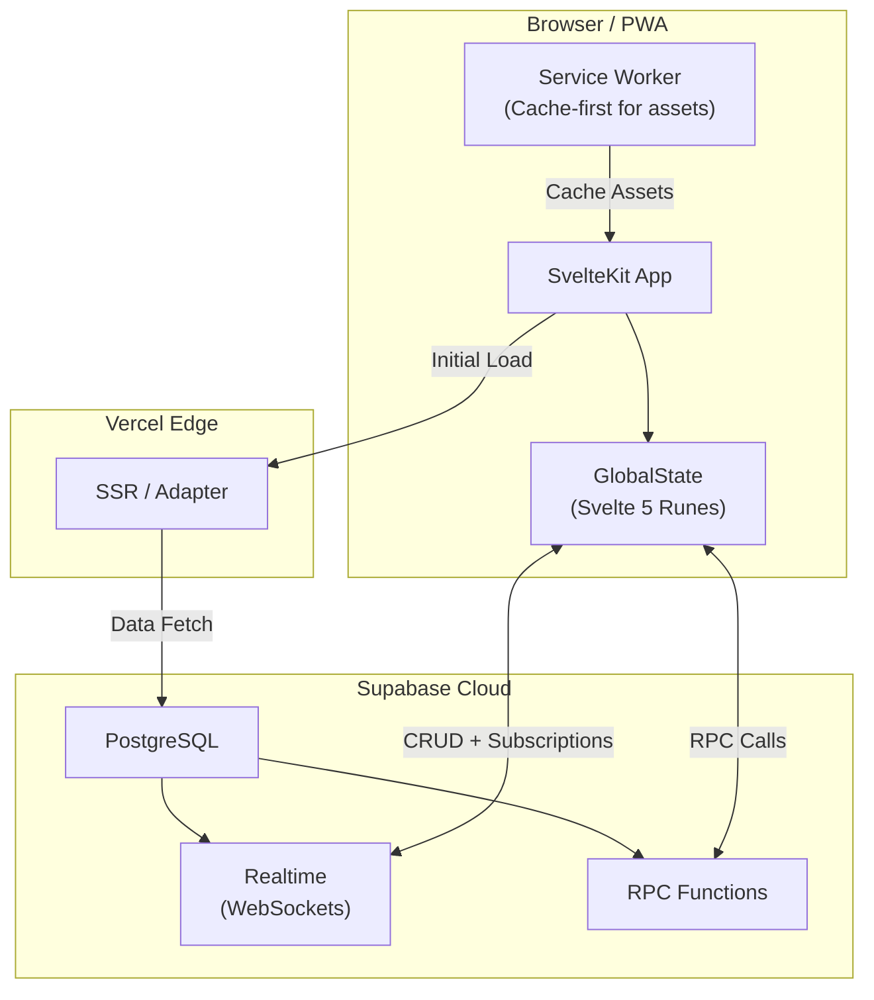
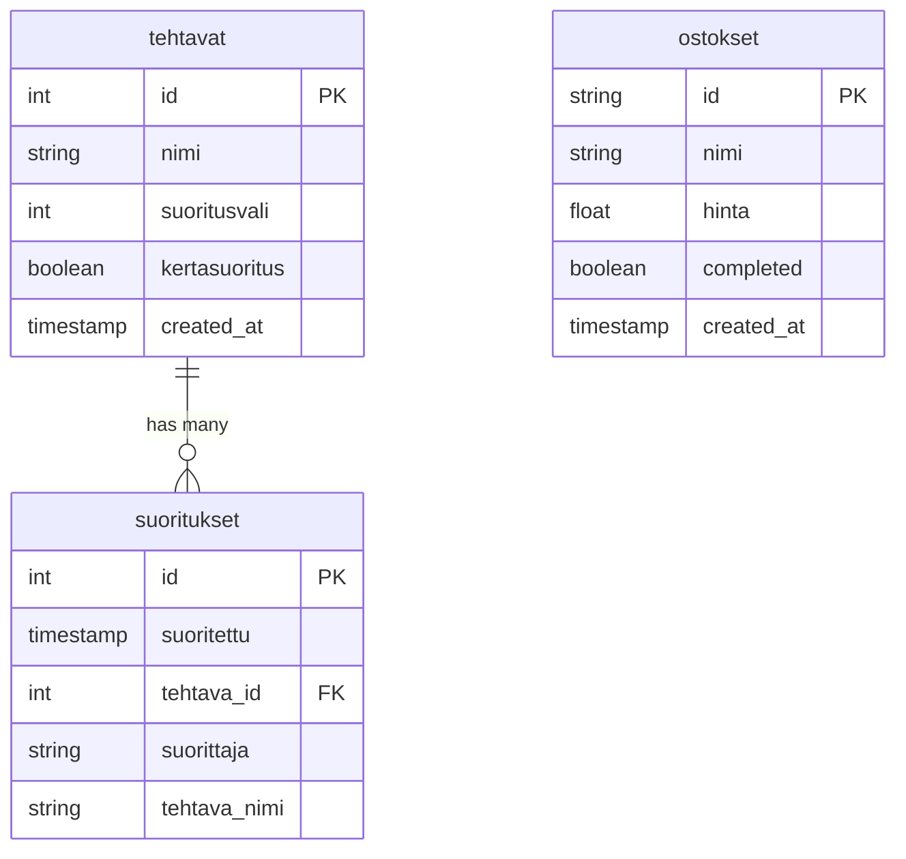
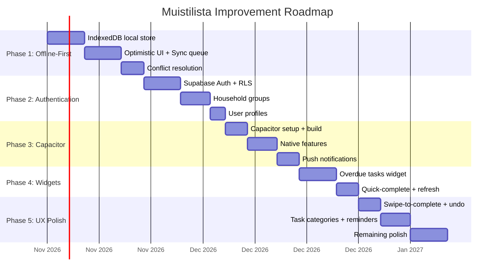

# 📋 Muistilista — Household Task & Reminder App

> A real-time, Finnish-language household management PWA built with **SvelteKit 5**, **Supabase**, and **TailwindCSS**. Designed for shared households to track recurring chores, shopping lists, and seasonal produce.

---

## Table of Contents

- [Overview](#overview)
- [Tech Stack](#tech-stack)
- [Architecture](#architecture)
- [Features](#features)
- [Data Model](#data-model)
- [Project Structure](#project-structure)
- [Planned Improvements](#-planned-improvements)

---

## Overview

**Muistilista** ("reminder list" in Finnish) is a Progressive Web App designed for households to collaboratively manage recurring tasks and chores. Each task has a configurable interval (in days), and the app visually communicates urgency through a color-coded system — from green (plenty of time) to red (overdue). The app syncs in real-time across all connected devices via Supabase Realtime, meaning any household member completing a task instantly updates every other user's view.

### Key Concepts

| Finnish Term | English | Description |
|---|---|---|
| **Tehtävä** | Task | A recurring or one-time household chore |
| **Suoritus** | Completion | A recorded instance of completing a task |
| **Suoritusväli** | Interval | Number of days between expected completions |
| **Kertasuoritus** | One-time task | A task that is auto-deleted after completion |
| **Ostoslista** | Shopping list | Shared grocery/shopping list |
| **Sesongissa** | In season | Seasonal produce calendar for Finland |

---

## Tech Stack

| Layer | Technology | Version |
|---|---|---|
| **Framework** | SvelteKit | 2.x |
| **UI Library** | Svelte | 5.x (Runes mode) |
| **Styling** | TailwindCSS | 3.4 |
| **Component Library** | Melt UI | 0.86 |
| **Backend / Database** | Supabase (PostgreSQL) | — |
| **Real-time** | Supabase Realtime (WebSockets) | — |
| **Date Formatting** | date-fns | 4.x |
| **Icons** | Custom SVG components + Lucide | — |
| **Deployment** | Vercel (Node.js 26.x) | — |
| **Language** | TypeScript | 5.x |
| **Fonts** | Gabarito (body), Pacifico (headings) | Custom |

---

## Architecture

### High-Level Overview



### State Management

The app uses a **singleton `GlobalState` class** powered by Svelte 5 runes (`$state`, `$derived`). This class:

1. **Initializes** by fetching tasks via a Supabase RPC function (`get_tehtavat_with_latest_suoritus`)
2. **Subscribes** to Supabase Realtime channels for `tehtavat` (tasks) and `suoritukset` (completions) tables
3. **Enriches** each task with computed `remainingTime` (days until due) and `edellinenSuoritus` (last completion date)
4. **Sorts** tasks by urgency (least remaining time first)
5. **Updates app badges** via the Badging API when tasks are overdue

### Service Worker

A custom service worker implements a **network-first strategy with cache fallback**:
- Build artifacts and static files are pre-cached on install
- Dynamic requests try the network first; on failure, serve from cache
- Old caches are purged on activation

### Rendering Strategy

- **Client-side data loading** (`+page.ts`) — data is fetched on the client via the Supabase JS client
- **SSR layout** — the root layout initializes `GlobalState` and renders the navigation shell
- Deployed on **Vercel** with the `@sveltejs/adapter-vercel` (Node.js 26.x runtime)

---

## Features

### 1. 📝 Task Management (`/`)

The home page displays all recurring household tasks as **color-coded cards** sorted by urgency:

| Remaining Time | Color | Meaning |
|---|---|---|
| ≤ 2 days | 🔴 Red | Overdue / Critical |
| ≤ 3 days | 🟠 Orange | Due soon |
| ≤ 5 days | 🟡 Yellow | Approaching |
| ≤ 14 days | 🟢 Green | On track |
| > 14 days | 🟩 Emerald | Plenty of time |

Each task card shows:
- Task name
- Last completion date
- Time remaining (human-readable, Finnish locale)
- Interval badge (e.g., "7pv" = 7 days)
- One-time task indicator (🔲 icon)

**Clicking a task** opens a dialog with options to:
- ✅ **Complete** (mark as done — requires confirmation tap)
- ✏️ **Edit** (name, interval, one-time toggle)
- 🗑️ **Delete** (requires confirmation tap)
- **Search/filter** tasks via a search bar

### 2. ➕ Add Task (`/lisaa`)

A form to create new tasks with:
- Task name (required)
- Interval in days (required)
- One-time task checkbox

### 3. 📊 Completion History (`/suoritukset`)

A sortable table of the latest 100 completions showing:
- Task name (clickable to filter)
- Completion date (clickable to edit)
- Who completed it

Features Supabase Realtime subscription for live updates. Includes a dialog for editing or deleting individual completions.

### 4. 🛒 Shopping List (`/ostoslista`)

> ⚠️ **Currently disabled** in the navigation (marked as "Ei käytössä" / not in use)

A shared shopping list with:
- Add items with name and price
- Check/uncheck items
- Inline editing
- Delete with confirmation
- Running total of unchecked items

### 5. 🍎 Seasonal Produce Calendar (`/sesongissa`)

A Finnish seasonal produce calendar showing what fruits, vegetables, root vegetables, mushrooms, and wild plants are in season for each month. Features:
- Month-to-month navigation (with wrap-around)
- Categorized cards with distinct color schemes
- Finnish alphabetical sorting
- Data sourced from a local JSON file (12 months, ~100+ items)

### 6. 🔔 Notifications & Badges

- **App Badge API** — shows the count of overdue tasks on the app icon
- **Notification permission** — prompts users with a pulsing bell icon
- **Notification support** — commented-out code for Android notification dots (ready to enable)

### 7. 📱 Responsive Navigation

- **Desktop**: Top navigation bar with gradient background and icon+text links
- **Mobile**: Bottom tab bar with floating action button (FAB) for adding tasks
- **Neon-style** animated logo with flicker and glow effects
- iOS safe area support (`env(safe-area-inset-bottom)`)

---

## Data Model

### Supabase Tables



### RPC Functions

| Function | Description |
|---|---|
| `get_tehtavat_with_latest_suoritus` | Returns all tasks joined with their most recent completion date |

### Realtime Subscriptions

| Channel | Tables | Events |
|---|---|---|
| `global-tehtavat-changes` | `tehtavat`, `suoritukset` | INSERT, UPDATE, DELETE |
| `suoritukset-changes` | `suoritukset` | INSERT, UPDATE, DELETE |

---

## Project Structure

```
muistilista_svelte/
├── src/
│   ├── app.css                    # Global styles, font imports, Tailwind directives
│   ├── app.d.ts                   # Global TypeScript interfaces (Tehtava, Suoritus, Ostos, EnrichedTehtava)
│   ├── app.html                   # HTML shell with PWA manifest link
│   ├── service-worker.ts          # Custom service worker (cache-first assets, network-first API)
│   ├── components/
│   │   ├── Navigaatio.svelte      # Responsive nav (desktop top bar + mobile bottom tabs)
│   │   ├── Tehtavat.svelte        # Task list with search/filter
│   │   ├── Tehtavarivi.svelte     # Individual task card (color-coded)
│   │   ├── TehtavaDialog.svelte   # Task detail/edit/complete/delete dialog
│   │   └── SuoritusDialog.svelte  # Completion edit/delete dialog
│   ├── lib/
│   │   ├── index.ts               # Utility functions (haeTehtavat, haeSuoritukset, laskeJaljellaOlevaAika)
│   │   ├── state.svelte.ts        # GlobalState singleton (Svelte 5 runes, Realtime subscriptions)
│   │   ├── supabase.ts            # Supabase client initialization
│   │   ├── data/
│   │   │   └── seasonalProduceData.json  # Finnish seasonal produce (12 months)
│   │   ├── fonts/
│   │   │   ├── Gabarito-VariableFont_wght.ttf
│   │   │   └── Pacifico-Regular.ttf
│   │   └── icons/                 # Custom SVG icon components (9 icons)
│   │       ├── BellIcon.svelte
│   │       ├── DeleteIcon.svelte
│   │       ├── FruitIcon.svelte
│   │       ├── MUIOneIcon.svelte
│   │       ├── PlusIcon.svelte
│   │       ├── SearchIcon.svelte
│   │       ├── SheetIcon.svelte
│   │       ├── ShoppingIcon.svelte
│   │       └── SquarePenIcon.svelte
│   └── routes/
│       ├── +layout.svelte         # Root layout (gradient bg, nav, state init)
│       ├── +page.svelte           # Home — task list
│       ├── +page.ts               # Home — data loader (RPC)
│       ├── lisaa/
│       │   └── +page.svelte       # Add new task form
│       ├── ostoslista/
│       │   ├── +page.svelte       # Shopping list (disabled)
│       │   └── +page.ts           # Shopping list data loader
│       ├── sesongissa/
│       │   └── +page.svelte       # Seasonal produce calendar
│       └── suoritukset/
│           ├── +page.svelte       # Completion history table
│           └── +page.ts           # Completions data loader
├── static/
│   ├── favicon.png                # App favicon (512x512)
│   ├── logo512.png                # PWA icon (512x512)
│   ├── logo512maskable.png        # Maskable PWA icon
│   ├── logo1024.png               # High-res icon (1024x1024)
│   ├── badge-icon.png             # Notification badge icon
│   ├── notification-icon.png      # Notification icon
│   └── manifest.json              # PWA web app manifest
├── package.json
├── svelte.config.js               # SvelteKit config (Vercel adapter, Melt UI preprocessor)
├── tailwind.config.ts
├── vite.config.ts
├── tsconfig.json
├── vercel.json                    # Vercel build config (Node 26)
└── .env                           # Supabase URL, Anon Key, Gemini API Key
```

---

## 🚀 Planned Improvements

### Phase 1: Foundation — Offline-First Architecture (✅ Valmis / Completed)

> **Goal**: Make the app fully usable without an internet connection. Static assets and dynamic data (tasks, completions, shopping list) are cached locally in IndexedDB; mutations update optimistically and sync to Supabase with an offline queue and conflict resolution.

| Feature | Description | Priority | Tila / Status |
|---|---|---|---|
| **IndexedDB local store** | Store all tasks, completions, and shopping list items in IndexedDB (via Dexie.js) as the primary data source | 🔴 Critical | ✅ Valmis |
| **Optimistic UI updates** | Apply mutations to local store immediately, then sync to Supabase in the background | 🔴 Critical | ✅ Valmis |
| **Sync queue** | Queue offline mutations (create, update, delete) and replay them when connectivity is restored | 🔴 Critical | ✅ Valmis |
| **Conflict resolution** | Implement last-write-wins and preserve pending offline edits during remote sync | 🟡 Important | ✅ Valmis |
| **Connectivity indicator** | Show a subtle banner when the app is offline, and a sync status indicator | 🟢 Nice to have | ✅ Valmis |
| **Background Sync API** | Use the Background Sync API to defer network requests until connectivity is restored | 🟢 Nice to have | ✅ Valmis |

---

### Phase 2: Authentication — Supabase Auth

> **Goal**: Secure the app with user accounts so each household can have its own private task list.

| Feature | Description | Priority |
|---|---|---|
| **Email/password auth** | Basic sign-up and sign-in with Supabase Auth | 🔴 Critical |
| **Magic link auth** | Passwordless login via email magic links | 🟡 Important |
| **OAuth providers** | Google and/or Apple sign-in for frictionless onboarding | 🟡 Important |
| **Household groups** | Allow users to create/join a household and share tasks within the group | 🔴 Critical |
| **Row Level Security (RLS)** | Enforce per-household data isolation at the database level | 🔴 Critical |
| **User profiles** | Replace hardcoded "Tuntematon" (unknown) completion performer with actual user names | 🟡 Important |
| **Auth-gated routes** | Protect all routes with authentication middleware (`hooks.server.ts`) | 🔴 Critical |
| **Session management** | Handle token refresh, session expiry, and secure cookie storage | 🟡 Important |

---

### Phase 3: Mobile Native — Capacitor Integration

> **Goal**: Package the web app as a native Android (and optionally iOS) app for better mobile experience and access to native APIs.

| Feature | Description | Priority |
|---|---|---|
| **Capacitor setup** | Initialize Capacitor project with Android platform | 🔴 Critical |
| **Adapter swap** | Switch from `adapter-vercel` to `adapter-static` for Capacitor builds (with separate build config) | 🔴 Critical |
| **Native splash screen** | Custom splash screen with Muistilista branding | 🟡 Important |
| **Status bar theming** | Match the gradient purple theme in the native status bar | 🟡 Important |
| **Haptic feedback** | Add vibration feedback on task completion and destructive actions | 🟢 Nice to have |
| **Native push notifications** | Use Firebase Cloud Messaging (FCM) for reliable push notifications on Android | 🟡 Important |
| **Deep links** | Support deep linking to specific tasks or views | 🟢 Nice to have |

---

### Phase 4: Android Home-Screen Widgets

> **Goal**: Provide at-a-glance task status and quick-complete actions directly from the Android home screen.

| Feature | Description | Priority |
|---|---|---|
| **Overdue tasks widget** | A compact widget showing the count and list of overdue/due-soon tasks | 🔴 Critical |
| **Quick-complete action** | Tap a task in the widget to mark it as completed without opening the app | 🟡 Important |
| **Shopping list widget** | A checklist widget for the shopping list with toggle support | 🟢 Nice to have |
| **Widget refresh** | Periodic background refresh + on-data-change push updates | 🟡 Important |
| **Capacitor plugin** | Use `@nicepkg/capacitor-android-widget` or a custom Capacitor plugin | 🔴 Critical |

---

### Phase 5: UX Enhancements

> **Goal**: Polish the user experience with features that make daily use delightful and efficient.

| Feature | Description | Priority |
|---|---|---|
| **Swipe-to-complete** | Swipe right on a task card to instantly mark it as done (with undo) | 🔴 High impact (✅ Valmis) |
| **Pull-to-refresh** | Native-feeling pull-to-refresh gesture on mobile | 🟡 Important |
| **Task categories / tags** | Group tasks by room, type, or custom tags (e.g., "Kitchen", "Bathroom", "Garden") | 🟡 Important |
| **Scheduled reminders** | Set specific time-of-day reminders for tasks that are due, via push notification | 🔴 High impact |
| **Task history chart** | Visual chart showing completion frequency over time (streak tracker) | 🟢 Nice to have |
| **Dark / light theme toggle** | Currently hardcoded to a purple gradient; add theme switching | 🟢 Nice to have |
| **Drag-to-reorder** | Allow manual reordering of tasks (pin important ones) | 🟢 Nice to have |
| **Onboarding flow** | First-launch tutorial explaining the app concept for new users | 🟡 Important |
| **Undo / snackbar** | Show a toast with "Undo" action after completing or deleting a task | 🔴 High impact (✅ Valmis) |
| **Animated transitions** | Page transitions and list animations (e.g., task flip/glide on completion) | 🟢 Nice to have (✅ Valmis) |
| **Multi-language support (i18n)** | Add English language support alongside Finnish | 🟢 Nice to have |
| **Accessibility audit** | ARIA labels, keyboard navigation, screen reader support, focus management | 🟡 Important |
| **Enable shopping list** | Finish and enable the `/ostoslista` route in navigation | 🟡 Important (✅ Valmis) |
| **Smart task suggestions** | Use AI (Gemini API key already present) to suggest common household tasks during onboarding | 🟢 Nice to have |

---

### Implementation Priority Roadmap



---

### Technical Debt & Quick Wins

These items should be addressed alongside the main phases:

| Item | Description |
|---|---|
| ⚠️ **Exposed secrets in `.env`** | Supabase anon key and Gemini API key are committed to git. Move to environment-only variables and rotate keys. |
| ✅ **Error boundaries** | Added SvelteKit `+error.svelte` page for graceful unhandled error display. |
| ✅ **Loading states & skeleton loaders** | Added task skeleton cards and empty states on home page while fetching or searching. |
| ✅ **Migrated to Svelte 5 runes** | Replaced legacy `$:` reactive declarations in `Navigaatio.svelte` with `$derived()`. |
| 🔧 **Hardcoded performer** | Completions are always attributed to "Tuntematon". Should use authenticated user name. |
| ✅ **Input validation** | Added `min="1"` constraint and programmatic verification for task intervals and names. |
| 🔧 **`vite-plugin-pwa` unused** | Listed as a dependency but not configured in `vite.config.ts`. Either integrate or remove. |
| 🔧 **Duplicate data fetching** | Both `+page.ts` and `GlobalState.init()` fetch the same tasks. Consolidate to one source. |

---

*Last updated: November 11, 2026*
